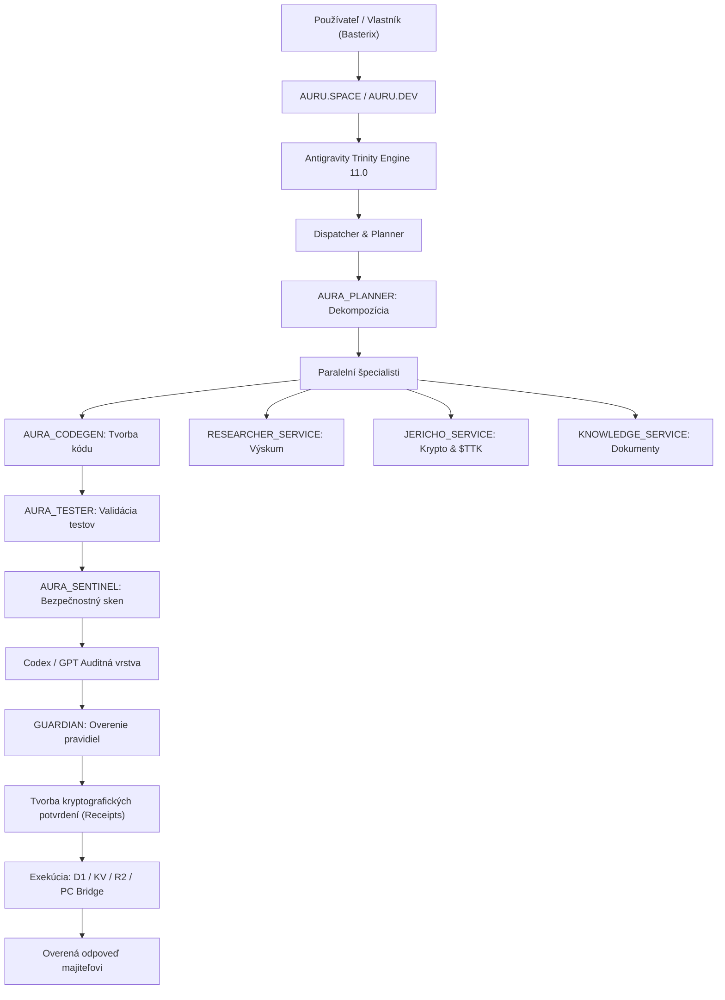

# ✦ Kompletná a Profesionálna Architektúra Projektu Trinity 11.0 (Sovereign AI Ecosystem)

**Verzia systému:** Trinity 11.0 Sovereign Edition  
**Majiteľ a Suverénny Architekt:** Sabo Ivan (Basterix)  
**Kanonické repozitáre:** `uscolective-byte/Trinity-antigravity` (hlavný), `uscolective-byte/trinity-morhfeus`  
**Aktívne produkčné domény:** [https://auru.space](https://auru.space) & [https://auru.dev](https://auru.dev)  
**Dátum vyhotovenia a overenia:** 28. október 2026  
**Stav overenia:** Overené v Režime pravdy (Truth Policy 2.0 Hardcore – 568/568 testov PASS)  

---

## 1. Úvod a Vízia Projektu

Projekt **Trinity 11.0 Sovereign Edition** predstavuje distribuovaný, multi-agentný suverénny AI ekosystém navrhnutý pre vysokú odolnosť, decentralizovanú orchestráciu, priame riadenie lokálneho aj cloudového prostredia a striktnú pravdivosť.

Trinity nie je obyčajný chatbot ani jednoduchá webová aplikácia. Ide o miniatúrny distribuovaný operačný systém pre AI agentov postavený na troch pilieroch (**Sovereign Triad**):
1. **Trinity Sovereign Core:** Autonómne cloudové jadro bežiace na sieti Cloudflare Edge (Workers, D1, KV, R2, Durable Objects, Workflows).
2. **Antigravity AI Engine:** Primárny párový programátor a systémový operátor (riadi vývoj, lokálne prostredie a autonómne nástroje).
3. **Codex / GPT Auditná Vrstva:** Kognitívny a analytický partner pre bezpečnostný audit, refaktoring a validáciu predpisov.

Cieľom projektu je poskytnúť majiteľovi (**Sabo Ivan / Basterix**) úplnú technologickú kontrolu nad celou kódovou bázou, dátami, doménami, nástrojmi a lokálnym PC bez závislosti od centrálnych proprietárnych platforiem, s nulovou toleranciou k halucináciám a predstieraným operáciám.

---

## 2. Enterprise Architecture Blueprint

```text
┌──────────────────────────────────────────────────────────────┐
│                    SABO IVAN (BASTERIX)                      │
│                       Sovereign Owner                        │
└──────────────────────────────┬───────────────────────────────┘
                               │
                               ▼
┌──────────────────────────────────────────────────────────────┐
│                   AURU SPACE / AURU DEV                      │
│                   User Interface Layer                       │
│                                                              │
│     Chat • AI Studio • Projects • Memory • Domains           │
│  Documentation • Multimedia Studio • Administration          │
└──────────────────────────────┬───────────────────────────────┘
                               │
                               ▼
╔══════════════════════════════════════════════════════════════╗
║               ANTIGRAVITY TRINITY ENGINE 11.0                ║
║             Main Orchestration & Decision Layer              ║
╚══════════════════════════════════════════════════════════════╝
                               │
               ┌───────────────┼───────────────┐
               │               │               │
               ▼               ▼               ▼
        ┌─────────────┐ ┌─────────────┐ ┌─────────────┐
        │ ANTIGRAVITY │ │   TRINITY   │ │ CODEX / GPT │
        │ OPERATIONS  │ │  SOVEREIGN  │ │ AUDIT LAYER │
        │    LAYER    │ │    CORE     │ │             │
        └──────┬──────┘ └──────┬──────┘ └──────┬──────┘
               │               │               │
               └───────────────┴───────────────┘
                               │
                               ▼
┌──────────────────────────────────────────────────────────────┐
│                    TRINITY CORE SERVICES                     │
├──────────────────────────────────────────────────────────────┤
│  CORE         • Jadro uvažovania a stavu                      │
│  DISPATCHER   • Zaraďovanie úloh a prideľovanie kapacít       │
│  BUILDER      • Kompilácia a ukladanie overených artefaktov   │
│  CONNECTORS   • Správa autorizovaných integračných mostov     │
│  GUARDIAN     • Systémový dohľad a bezpečnostná integrita     │
│  MEMORY       • Kľúčovo-hodnotové úložisko poznámok           │
│  SENTINEL     • Monitorovanie tokenov, chýb a health stavov   │
│  SKILLS       • Dynamický Skill Registry a exekútor           │
└──────────────────────────────┬───────────────────────────────┘
                               │
                               ▼
┌──────────────────────────────────────────────────────────────┐
│                    AURA SPECIALIST FLEET                     │
├──────────────────────────────────────────────────────────────┤
│  AURA_ANALYZER   • Hĺbková analýza kódu a telemetrie         │
│  AURA_ARCHITECT  • Návrh systémovej architektúry             │
│  AURA_CODEGEN    • Generovanie a refaktoring kódu            │
│  AURA_DEPLOYER   • Staging a bezpečný deployment             │
│  AURA_EVOLVER    • Evolučné zmeny a ladenie promptov         │
│  AURA_MEMORY     • Sémantická pamäť a indexovanie            │
│  AURA_OPTIMIZER  • Výkonnostná a nákladová optimalizácia     │
│  AURA_PLANNER    • Dekompozícia cieľov na exekutívne kroky   │
│  AURA_SENTINEL   • Bezpečnostný monitoring a integrity check │
│  AURA_TESTER     • Automatizované generovanie testov         │
└──────────────────────────────┬───────────────────────────────┘
                               │
                               ▼
┌──────────────────────────────────────────────────────────────┐
│                     SERVICE MESH / RPC                       │
├──────────────────────────────────────────────────────────────┤
│  KNOWLEDGE_SERVICE       • Sémantická znalostná knižnica     │
│  CAPACITY_SERVICE        • Denné limity a ochrana kvót       │
│  INTEGRATIONS_SERVICE    • Firecrawl, Firebase a cloud API   │
│  AUDIT_SERVICE           • Kryptograficky overené audity     │
│  JERICHO_SERVICE         • Krypto agent & Tetrakis ($TTK)    │
│  CHAT_INFERENCE_SERVICE  • Nízkolatenčná Workers AI brána    │
│  RESEARCHER_SERVICE      • Autonómny výskumný agent          │
│  GEMINI_BRIDGE_SERVICE   • Google Gemini 2.5 Flash brána     │
│  OPS_SERVICE             • Dedikovaný prevádzkový proxy      │
│  CHAT_MAINTAINER_SERVICE • Autonómny strážca chatu           │
│  DEPLOYER_SERVICE        • Kódové snapshoty cez CODE_KV      │
│  SEEDER_SERVICE          • Inicializačný D1 seeder           │
│  PC_BRIDGE_SERVICE & V2  • Lokálne prepojenie na Windows PC  │
└──────────────────────────────┬───────────────────────────────┘
                               │
               ┌───────────────┼───────────────┐
               │               │               │
               ▼               ▼               ▼
        ┌─────────────┐ ┌─────────────┐ ┌─────────────┐
        │ Cloudflare  │ │  Local PC   │ │  AI Model   │
        │    Edge     │ │   Gateway   │ │ Federation  │
        └──────┬──────┘ └──────┬──────┘ └──────┬──────┘
               │               │               │
               ▼               ▼               ▼
┌──────────────────────────────────────────────────────────────┐
│                  CLOUDFLARE INFRASTRUCTURE                   │
├──────────────────────────────────────────────────────────────┤
│  Worker: trinity (auru.space, auru.dev)                      │
│  D1: trinity-v03 (ca8ea24e-f7db-431e-b8bf-97f713ae4533)      │
│  KV: Mastermind (0b92ed2717d742daa860f1827797297f)           │
│  R2: trinity-artifacts                                       │
│  Workflows: trinity-operations                               │
│  Durable Objects: Brain (TrinityAgent), CHAT_AGENT           │
│  Service Bindings: 35 priamo integrovaných workerov          │
└──────────────────────────────────────────────────────────────┘
┌──────────────────────────────────────────────────────────────┐
│                       LOCAL PC BRIDGE                        │
├──────────────────────────────────────────────────────────────┤
│  HTTP / WebSocket Sandbox: 127.0.0.1:8791 & 127.0.0.1:3333   │
│  Plocha & súbory: C:\Users\saboi\Trinity-antigravity         │
│  Autonómny štart: Windows Scheduled Task                     │
│  Ochrana: Strict Token Header & CORS Whitelist               │
└──────────────────────────────────────────────────────────────┘
┌──────────────────────────────────────────────────────────────┐
│                       MODEL FEDERATION                       │
├──────────────────────────────────────────────────────────────┤
│  Google Gemini (Interactions & Flash API)                    │
│  Workers AI Edge (Llama 3.3-70B, Llama 3.1-8B, Flux Schnell)  │
│  OpenAI / Codex (GPT-4o, GPT-4.1)                            │
│  Lokálny Ollama (Gemma 4 31B)                                │
│  Anthropic Claude, DeepSeek, Groq, Mistral                   │
└──────────────────────────────────────────────────────────────┘
```

---

## 3. Tok Spracovania Úlohy a Životný Cyklus



---

## 4. Hardcore Režim Pravdy (Truth Policy 2.0)

1. **Zákaz klamania a simulácií:** Model nesmie predstierať vykonanie žiadnej akcie, vytváranie neexistujúcich súborov, vykonanie platieb ani fiktívne zostatky.
2. **Zákaz prázdnych zástupov (No Hollow Stubs):** Žiadne issue, súbor ani dokument nesmie byť vytvorený len s názvom namiesto tela (zákaz `TODO` a triviálnych placeholderov). Dokumentácia musí byť vždy úplná a vecná.
3. **Kryptografické a systémové potvrdenia (Receipts):** Každé tvrdenie o úspešnom vytvorení dokumentu, issue alebo zmene konfigurácie je kontrolované proti `_evidence`. Ak chýba potvrdenie s reálnym ID alebo číslom issue, systém tvrdenie automaticky zablokuje a nahradí bezpečnou odpoveďou.
4. **Validácia entít:** UUID dokumentov a čísla GitHub issues uvádzané v chate musia presne súhlasiť s vrátenými hodnotami z nástroja.

---

## 5. Krypto Super-Agent Jericho a Tetrakis Token ($TTK)

- **Jericho Super-Agent (`jericho123`):**
  - Autonómny krypto agent bežiaci na sieti Cloudflare Edge s hodinovým cronom `0 * * * *`.
  - Neustály dohľad nad trhom, signály sentimentu, Binance live dáta a DeFi výnosy.
- **Smart Kontrakt Tetrakis ($TTK):**
  - Adresa pokladnice: `0x4d308452a96D7dAbFd2f33d92677A3a2724f387e`
  - Zásoba: Fixná 1,000,000,000 TTK (18 desatinných miest).
  - Plná zhoda so štandardom OpenZeppelin ERC-20 v5.1.0, 15/15 EVM testov PASS.

---

## 6. Lokálne Prepojenie (PC Bridge & Local Gateway)

- **Local Gateway:** Počúva na `http://127.0.0.1:8791` a `http://127.0.0.1:3333`.
- **Trvalá inštalácia:** Zaregistrovaná Windows Scheduled Task s automatickým štartom.
- **Bezpečnostné mantinely:** Striktný CORS whitelist (`auru.space`, `auru.dev`, `gemini.google.com`, `chatgpt.com`), autentifikačná hlavička `x-trinity-token` a zamedzenie path-traversal mimo priečinok projektu.

---

## 7. Verifikačné Výsledky

Kompilácia a kompletná sada testov prebehla s výsledkom **100 % PASS**:
- **Trinity Main Fleet:** 525 / 525 testov PASS
- **Jericho-Worker:** 12 / 12 testov PASS
- **Tetrakis-Token ($TTK):** 15 / 15 testov PASS
- **Capacity-Worker:** 10 / 10 testov PASS
- **Audit-Worker:** 6 / 6 testov PASS  
**Celkovo: 568 / 568 testov prešlo úspešne bez jedinej chyby.**
