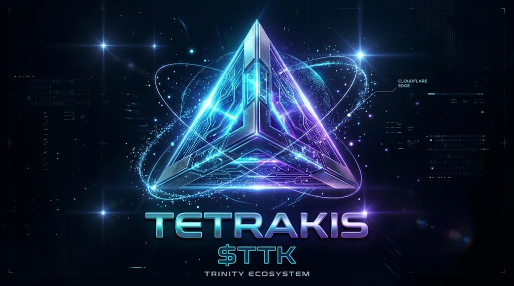

# TETRAKIS ($TTK) WHITEPAPER
## The Fuel of the Autonomous Edge — Trinity Omni-Core

- **Slogan**: *"Tetrakis ($TTK) – Fuel of the Autonomous Edge."*
- **Root Architect**: Ivan Sabo (Basterix) [Ring 0 Sovereign]
- **Canonical Production Domains**: `https://auru.space` / `https://auru.dev` (unified Cloudflare Worker `trinity`)
- **Target L2 Networks**: Base Mainnet (`Chain ID: 8453`) / Base Sepolia (`Chain ID: 84532`)
- **Edge Services**: `Trinity/src/crypto-value-engine.js`, Worker #24 (`trinity-treasury`), Worker #26 (`jericho123`)
- **Official Logo Asset**: `public/assets/tetrakis-logo.png` (served at `/tetrakis-logo.png`; `1024x572` RGBA PNG, SHA-256: `b22b0981bdcd1e50442dc98932c43ef5f0f35a6662a275975b4565bf7bb31496`)

---

## Chapter 1: Genesis & Four-Pillar Ecosystem Utility

### Tetrakis ($TTK): Native Utility Layer of Trinity Omni-Core

The name **Tetrakis** comes from the **tetrahedron** — the most stable geometric solid in three-dimensional space: four vertices, four faces, complete structural balance.

Within the Trinity Omni-Core ecosystem, Tetrakis (`$TTK`) is designed as the native utility currency connecting communication, payments, AI creation, digital identity, and non-custodial user ownership across **four ecosystem pillars**:

1. **Native In-Chat Payments & Instant P2P Transfers**
   - Direct wallet-to-wallet `$TTK` transfers, tipping, and payment requests directly inside **Trinity Messenger** and **`@wallet`** without leaving the conversation.
2. **Mini-Apps, AI Studio & Bot Economy**
   - Native payment currency for **Trinity AI Studio** web apps, autonomous agents, skills, plugins, and micro-services operating inside the Trinity ecosystem.
3. **Domains, Handles & Digital Assets**
   - Utility token for ecosystem usernames and handles, domain registration/leasing services, edge hosting, and verifiable digital assets or collectibles.
4. **Creator & Compute Economy / Non-Custodial Space**
   - User-owned non-custodial **Tetrakis Space** (where private keys remain exclusively in the user's wallet) alongside `@wallet`, supporting creator payouts, edge compute/storage settlement, and ecosystem participation.

> **Truth Policy 2.1 Boundary (Vision vs. Verified State):** The four pillars above define the **target ecosystem utility architecture** of Tetrakis (`$TTK`). Live payment execution and credit settlement remain strictly **fail-closed** until on-chain contract deployment, RPC chain ID, runtime bytecode hash, and invoice/service binding are cryptographically verified.

---

## Chapter 2: On-Chain Smart Contract Specification & Tokenomics (Base L2)

Canonical source contract: `contracts/tetrakis/TetrakisToken.sol` (mirrored byte-for-byte at `packages/crypto-core/contracts/TetrakisToken.sol`).

| Parameter | Verified Contract Specification |
|---|---|
| **Token Name** | `Tetrakis` |
| **Symbol** | `TTK` |
| **Decimals** | `18` |
| **Token Standard** | Standard `ERC-20` (`OpenZeppelin ERC20 v5.1.0`, Solidity `0.8.24`, Shanghai EVM). **Does NOT implement EIP-2612 Permit.** |
| **Total Supply (Fixed)** | `1,000,000,000 TTK` (`1_000_000_000 * 10**18`) — minted once in constructor; **no `mint` function exists** |
| **Initial Allocation** | `1,000,000 TTK` to `BASTERIX_WALLET` (`0x7e17f9072cfCbc7fE45973De0F11eC8db99281e4`) + `999,000,000 TTK` to `INITIAL_TREASURY` (`0x4d308452a96D7dAbFd2f33d92677A3a2724f387e`) |
| **Immutability & Safety** | 0% transfer tax, no `mint`, no `burn`, no `pause`, no blacklist, no proxy/upgrade backdoor |
| **On-Chain Deployment Status** | **NOT YET VERIFIED ON-CHAIN** unless actively proven via `scripts/verify-tetrakis.mjs` and `GET /api/assistant/crypto/tetrakis` |
| **Market Price Policy** | **`market_price: null` (`unavailable`)** until backed by a verified live market feed — Trinity never fabricates a `$TTK` EUR/USD price or guaranteed yield |
| **Compiled Bytecode SHA-256** | `0x5212f569578e0379edc4f0228663d72aaa3a6bff3bfa99d7266c5c4b657edbb6` (`solc 0.8.24`, `contracts/tetrakis/build/TetrakisToken.json`) |
| **Runtime Bytecode Keccak-256** | `0x3d8a3c7a764f1b12aa17052d6d8772e1924a3395c1ffd52024891f5e794bb705` |

---

## Chapter 3: Verification, Non-Custodial Security & Ecosystem Activation

### 3.1 Fail-Closed Verification Pipeline
Before Tetrakis Space enables on-chain payment submission (`payments.enabled: true`), `Trinity/src/crypto-value-engine.js` enforces all of the following checks:
1. Valid `TTK_CHAIN_ID` (`8453` Base Mainnet or `84532` Base Sepolia) and non-zero EVM `TTK_CONTRACT_ADDRESS`.
2. Live JSON-RPC `eth_chainId` matches the configured chain ID.
3. Live JSON-RPC `eth_getCode` returns deployed contract bytecode whose `keccak_256` hash equals `TTK_RUNTIME_KECCAK256`.
4. Valid non-zero `TTK_PAYMENT_RECIPIENT` is configured.
5. Independent CLI verification can be executed at any time via `scripts/verify-tetrakis.mjs` against a single pinned block tag.

### 3.2 Non-Custodial Wallet Ownership
- Users sign every transaction client-side through their own EIP-1193 wallet inside **Tetrakis Space**.
- Trinity never asks for, stores, or transmits user seed phrases or private keys.
- A direct `$TTK` transfer does not automatically unlock Trinity platform credits or services until explicitly bound to a verified invoice/service order.

### 3.3 Planned Liquidity & Listing Roadmap (Subject to Live Verification)
1. **Step 1 — Base L2 Contract Deployment & Verification**: Deploy `TetrakisToken.sol` on Base Mainnet (`8453`), verify source on BaseScan, and validate with `scripts/verify-tetrakis.mjs`.
2. **Step 2 — DEX Liquidity Pool (Aerodrome / Uniswap v3 on Base)**: Provide initial `$TTK / $USDC` liquidity once mainnet deployment is verified.
3. **Step 3 — Liquidity Lock (LP Lock)**: Lock LP tokens via **UNCX Network** for 6–12 months as verifiable proof of commitment.
4. **Step 4 — Market Indexing**: Index verified pools on **DexScreener**, **CoinGecko**, and **CoinMarketCap** before enabling live market price feeds.
5. **Step 5 — Exchange Expansion**: Progressively pursue verified exchange listings (Tier 3 toward Tier 1) as real ecosystem usage grows.

---

### The Architect's Oath
> *"We do not build servers that can be switched off. We do not build a currency that can be inflated. Tetrakis is a sovereign utility foundation locked in immutable code. Ring 0 holds the key. The future is autonomous."*

